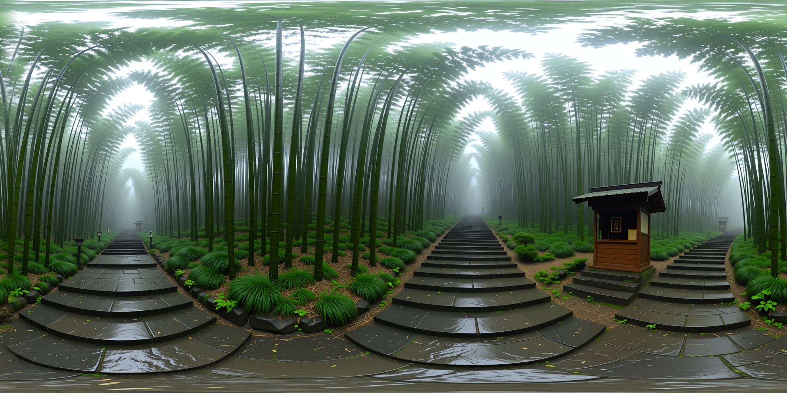

# Sciescape

## Somewhere starts with a sentence.



**An independent research prototype by Navish Kumar.**

Imagine a place, step inside, and learn with a lifelike guide who understands the world you share. Sciescape investigates a dependable stack for spoken world creation, coherent movement, scene-grounded conversation and embodied presence.

**[Explore the visual showcase →](https://kumarnavish.github.io/sciescape-research/)**

### What exists

The working text-to-panorama pipeline has produced the five archived scenes below. This repository preserves the original image bytes and makes their provenance inspectable.

| Scene | Evidence |
| --- | --- |
| [Bamboo after rain](assets/bamboo.png) | Generated 360° panorama · mist, bamboo and wet stone paths |
| [Canal at dusk](assets/canal.png) | Generated 360° panorama · water, architecture and evening light |
| [Mountain hut](assets/hut.png) | Generated 360° panorama · a wooden interior with mountain views |
| [Quiet reading room](assets/reading-room.png) | Generated 360° panorama · a furnished interior |
| [Desert oasis](assets/oasis.png) | Generated 360° panorama · an open desert landscape |

The public research code also includes a bounded batch-runner example and tests in [`research/`](research/), supporting checkpointing, interrupted-run recovery and time limits for compute-constrained experiments.

### The next question

**Can a world keep its identity—and a guide its understanding—as a person moves, speaks and changes it?**

- **Coherent worlds:** stable geometry, object identity and edits across viewpoints.
- **Embodied presence:** a stronger lifelike 3D guide grounded in the scene and the visitor’s attention.
- **Natural interaction:** voice, world creation and reasoning in one continuous journey.

The images demonstrate generated visual outputs. They do not establish reliable free walking, persistent world edits, a lifelike interactive avatar or a validated end-to-end voice/XR experience. Technical novelty remains a research question to test through repeatable experiments and fair comparisons.

[Evidence, provenance and limits](EVIDENCE.md) · [Research direction](RESEARCH.md) · [License and attribution](LICENSE)

### Run the showcase locally

```sh
git clone https://github.com/KumarNavish/sciescape-research.git
cd sciescape-research
python3 -m http.server 8197 --bind 127.0.0.1
```

Open `http://127.0.0.1:8197`. No build step, package install, API key or GPU is needed. The static page uses local media and system fonts, respects reduced motion and supports keyboard navigation. Open any of the five worlds to look around a perspective-correct 360° panorama using drag, touch, arrow keys or the view controls. Escape returns focus to the entry link. These are image-based previews from one position, not free-walking geometry or a live voice demo.

The dependency-free WebGL viewer loads only on entry, draws only when needed, caps its drawing buffer at two million pixels, and releases its graphics resources on close. Unsupported devices retain a flat-image fallback and a link to the original. There are no trackers, background videos, continuous render loops or paid API calls.

This public showcase is separate from the private Sciescape application. It contains selected research outputs and public research code, not credentials or private operational records.

Showcase verification (15 November 2026): all five interactive views, keyboard/focus recovery, responsive layouts, reduced motion and loading fallback checked in Chrome. [Validation record](evidence/showcase-validation.json).
